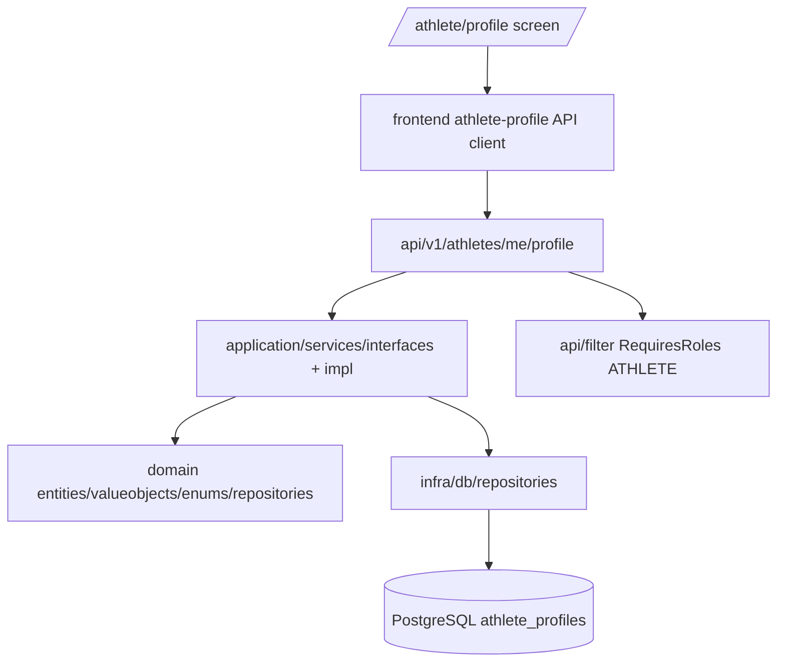

# Athlete Profile Design

**Spec**: `specs/active/athlete-profile/spec.md`
**Status**: Draft

---

## Architecture Overview

Athlete Profile is implemented as an authenticated "me" resource. The frontend never sends a user ID for ownership; the API derives ownership from the validated access token and permits only `ATHLETE`.



---

## Code Reuse Analysis

### Existing Components to Leverage

| Component | Location | How to Use |
| --- | --- | --- |
| Access-token role filter | `backend/src/main/java/com/squadra/platform/api/filter/AccessTokenAuthorizationFilter.java` | Protect profile endpoints with `@RequiresRoles(ATHLETE)` and read the verified token from request context. |
| Authentication JWT claims | `backend/src/main/java/com/squadra/platform/domain/services/AccessTokenVerifier.java` | Use `VerifiedAccessToken.userId()` as the only owner ID source. |
| API request/response split | `backend/src/main/java/com/squadra/platform/api/v1/auth/request` and `response` | Mirror request/response DTO organization under `api/v1/athletes/profile`. |
| Layer-first backend structure | `backend/src/main/java/com/squadra/platform` | Add files only under responsibility folders, not layer roots. |
| JDBC timestamp/date helpers | `backend/src/main/java/com/squadra/platform/infra/db/adapters/ReactiveJdbcSupport.java` | Reuse worker-isolated repository pattern until persistence stack is upgraded. |
| Auth context | `frontend/src/features/auth/auth-context.tsx` | Use access token and refresh retry for authenticated profile requests. |
| React Query provider | `frontend/src/providers.tsx` | Load and mutate profile server state with TanStack Query. |
| Existing form stack | `frontend/src/features/auth/forms.tsx` | Reuse React Hook Form + Zod patterns for validation and error display. |

### Integration Points

| System | Integration Method |
| --- | --- |
| Authentication | `Authorization: Bearer <accessToken>` plus `@RequiresRoles(UserRole.ATHLETE)` on backend. |
| Database | New Flyway migration `V3__create_athlete_profiles.sql` creates `squadra.athlete_profiles`. |
| Frontend routing | New App Router page at `frontend/src/app/athlete/profile/page.tsx`. |

---

## Components

### AthleteProfileResource

- **Purpose**: Owns HTTP transport for reading and saving the authenticated athlete's profile.
- **Location**: `backend/src/main/java/com/squadra/platform/api/v1/athletes/profile/AthleteProfileResource.java`
- **Interfaces**:
  - `get(ContainerRequestContext): Uni<Response>` returns current athlete profile or `404`.
  - `put(ProfileUpsertRequest, ContainerRequestContext): Uni<ProfileResponse>` upserts current athlete profile.
- **Dependencies**: `AthleteProfileService`, `VerifiedAccessToken`.
- **Reuses**: `@RequiresRoles`, request-context access-token property, validation mapper style.

### AthleteProfileService

- **Purpose**: Orchestrates profile retrieval, validation and upsert for the current athlete.
- **Location**:
  - Interface: `backend/src/main/java/com/squadra/platform/application/services/interfaces/AthleteProfileService.java`
  - Implementation: `backend/src/main/java/com/squadra/platform/application/services/impl/DefaultAthleteProfileService.java`
- **Interfaces**:
  - `Uni<Optional<AthleteProfile>> findMine(UUID userId)`
  - `Uni<AthleteProfile> saveMine(UUID userId, SaveAthleteProfileCommand command)`
- **Dependencies**: `AthleteProfileRepository`.
- **Reuses**: Existing application service split and Mutiny use-case style.

### AthleteProfile Domain Model

- **Purpose**: Represents athlete-owned, team-independent sports identity.
- **Location**:
  - Entity: `backend/src/main/java/com/squadra/platform/domain/entities/AthleteProfile.java`
  - Enums: `backend/src/main/java/com/squadra/platform/domain/enums/FootballPosition.java`, `DominantFoot.java`
  - Repository contract: `backend/src/main/java/com/squadra/platform/domain/repositories/AthleteProfileRepository.java`
- **Interfaces**:
  - `AthleteProfile.create(...)`
  - `AthleteProfile.update(...)`
  - `AthleteProfile.validate(...)`
- **Dependencies**: Pure Java only.
- **Reuses**: Existing domain entity style.

### JdbcAthleteProfileRepository

- **Purpose**: Persists athlete profiles with one row per athlete user.
- **Location**: `backend/src/main/java/com/squadra/platform/infra/db/repositories/JdbcAthleteProfileRepository.java`
- **Interfaces**:
  - `Uni<Optional<AthleteProfile>> findByUserId(UUID userId)`
  - `Uni<AthleteProfile> upsert(AthleteProfile profile)`
- **Dependencies**: `DataSource`, `ReactiveJdbcSupport`.
- **Reuses**: Existing repository adapter pattern and explicit date/time binding.

### Athlete Profile Frontend Feature

- **Purpose**: Provides the athlete-owned profile form and authenticated API client.
- **Location**:
  - API client: `frontend/src/features/athlete-profile/api.ts`
  - Form: `frontend/src/features/athlete-profile/form.tsx`
  - Page: `frontend/src/app/athlete/profile/page.tsx`
- **Interfaces**:
  - `getProfile(accessToken): Promise<AthleteProfile>`
  - `saveProfile(accessToken, input): Promise<AthleteProfile>`
  - `AthleteProfileForm`
- **Dependencies**: `useAuth`, TanStack Query, React Hook Form, Zod.
- **Reuses**: Existing frontend provider and auth refresh model.

---

## Data Models

### Backend Domain

```java
class AthleteProfile {
    UUID id;
    UUID userId;
    String displayName;
    String fullName;
    LocalDate birthDate;
    FootballPosition primaryPosition;
    Set<FootballPosition> secondaryPositions;
    DominantFoot dominantFoot;
    Integer jerseyNumber;
    String city;
    String state;
    String bio;
    Instant createdAt;
    Instant updatedAt;
}
```

### Database

```sql
CREATE TABLE squadra.athlete_profiles (
    id UUID PRIMARY KEY,
    user_id UUID NOT NULL UNIQUE REFERENCES squadra.users(id) ON DELETE CASCADE,
    display_name VARCHAR(60) NOT NULL,
    full_name VARCHAR(120),
    birth_date DATE,
    primary_position VARCHAR(20) NOT NULL,
    secondary_positions VARCHAR(20)[] NOT NULL DEFAULT ARRAY[]::VARCHAR(20)[],
    dominant_foot VARCHAR(10),
    jersey_number INTEGER,
    city VARCHAR(80),
    state VARCHAR(80),
    bio VARCHAR(280),
    created_at TIMESTAMP WITH TIME ZONE NOT NULL,
    updated_at TIMESTAMP WITH TIME ZONE NOT NULL
);
```

### Frontend Types

```typescript
type FootballPosition = "GOALKEEPER" | "DEFENDER" | "MIDFIELDER" | "FORWARD";
type DominantFoot = "LEFT" | "RIGHT" | "BOTH";

interface AthleteProfile {
  id: string;
  displayName: string;
  fullName?: string;
  birthDate?: string;
  primaryPosition: FootballPosition;
  secondaryPositions: FootballPosition[];
  dominantFoot?: DominantFoot;
  jerseyNumber?: number;
  city?: string;
  state?: string;
  bio?: string;
  createdAt: string;
  updatedAt: string;
}
```

---

## API Contract

| Method | Path | Auth | Behavior |
| --- | --- | --- | --- |
| `GET` | `/api/v1/athletes/me/profile` | ATHLETE | Returns current profile or `404 PROFILE_NOT_FOUND`. |
| `PUT` | `/api/v1/athletes/me/profile` | ATHLETE | Creates or updates current athlete profile and returns `200`. |

---

## Error Handling Strategy

| Error Scenario | Handling | User Impact |
| --- | --- | --- |
| Missing/invalid token | Existing filter returns `401`. | User sees sign-in recovery/error flow. |
| Wrong global role | Existing filter returns `403`. | Organizer cannot access athlete-only profile. |
| Profile missing on GET | API returns `404 PROFILE_NOT_FOUND`. | UI shows create-profile empty state. |
| Invalid profile data | API returns `422 VALIDATION_FAILED`. | UI keeps typed values and shows validation guidance. |
| DB uniqueness race | Repository upsert keeps one row by `user_id`. | Last valid save wins without duplicate rows. |

---

## Risks & Concerns

| Concern | Location | Impact | Mitigation |
| --- | --- | --- | --- |
| Current persistence uses worker-isolated JDBC rather than Hibernate Reactive | `backend/src/main/java/com/squadra/platform/infra/db/adapters/ReactiveJdbcSupport.java` | New DB work follows existing pattern but is not the preferred long-term reactive persistence stack. | Keep repository API reactive and isolated on worker pool, add no event-loop blocking, and keep the adapter swappable for Hibernate Reactive later. |
| Frontend access token only lives in memory | `frontend/src/features/auth/auth-context.tsx` | Direct page refresh may require refresh before profile API calls can succeed. | Profile API hook performs one refresh-token recovery before surfacing auth failure. |
| Profile includes personal data | `docs/security-business-constraints.md` | Over-collection or accidental public exposure could violate privacy rules. | Keep fields minimal, private, authenticated and not exposed through public endpoints. |

---

## Tech Decisions

| Decision | Choice | Rationale |
| --- | --- | --- |
| Ownership API | `/athletes/me/profile` | Prevents trusting client-supplied user IDs and matches security guidance. |
| Save semantic | Idempotent `PUT` upsert | One endpoint supports create/edit and handles retry safely. |
| Profile visibility | Private in MVP | Matches docs excluding public search/social surfaces. |
| Form tone | Sports profile, not generic account settings | Follows Squadra UI/design skill for athlete motivation and football-first framing. |
