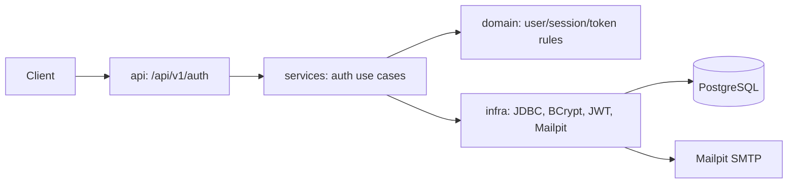

# Authentication Design

**Spec**: `specs/active/authentication/spec.md`

## Architecture

Authentication is implemented in the existing backend layers; no separate domain folder is introduced.

## Components

| Layer | Location | Responsibility |
| --- | --- | --- |
| API | `com.squadra.platform.api` | DTO validation, `201/200/202/204/401/422` responses, refresh-cookie policy. |
| Services | `com.squadra.platform.services` | Register, login, refresh, logout, recovery, and reset orchestration. |
| Domain | `com.squadra.platform.domain` | User role, password policy, refresh-session and reset-token invariants, repository ports. |
| Infra | `com.squadra.platform.infra` | Parameterized JDBC repositories, BCrypt, JWT signing/validation, random token hashing, Mailpit adapter. |

## API Contract

| Endpoint | Behavior | Response |
| --- | --- | --- |
| `POST /api/v1/auth/register` | Create ATHLETE or ORGANIZER | `201` without credentials |
| `POST /api/v1/auth/login` | Validate credentials | `200` access token + refresh cookie |
| `POST /api/v1/auth/refresh` | Rotate valid refresh token | `200` access token + replacement cookie |
| `POST /api/v1/auth/logout` | Revoke refresh session | `204` + cleared cookie |
| `POST /api/v1/auth/password-recovery` | Request reset | `202` regardless of account existence |
| `POST /api/v1/auth/password-reset` | Consume reset token | `204` and revoke user sessions |

## Persistence

Flyway adds `users`, `refresh_tokens`, and `password_reset_tokens`. User email is unique. Only SHA-256 token hashes are stored. Refresh sessions expire after 30 days; reset tokens expire after 30 minutes and can be consumed once.

## Security

- Passwords use BCrypt; never log or return passwords, access tokens, refresh tokens, or reset tokens.
- Access JWT uses issuer, expiry, and role claims; lifespan is 15 minutes.
- Refresh cookie is `HttpOnly`, `Secure`, `SameSite=Strict`, and scoped to `/api/v1/auth`.
- Login and recovery responses are enumeration-safe.
- `ATHLETE` and `ORGANIZER` are the only self-service registration roles. Contextual permissions remain resource-specific and server-enforced.
- Production secrets come from environment/secret management; Mailpit is local development only.

## Tests

Integration tests assert each API status and cookie behavior. Unit tests cover password policy, role restriction, refresh rotation/revocation, reset-token expiry/single-use, and generic failure behavior. Coverage target is at least 80%.
