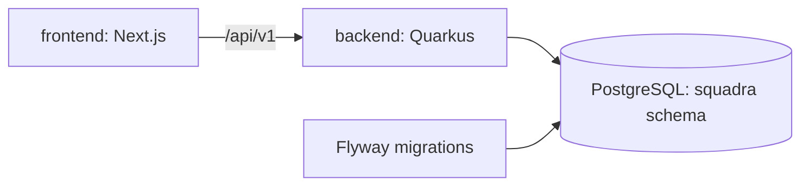

# Squadra Project Foundation Design

**Spec**: `specs/active/project-foundation/spec.md`
**Status**: Approved by request

## Architecture Overview

The project has independent frontend and backend applications. Next.js is a thin client, Quarkus is the policy and domain boundary, and PostgreSQL is accessed only by the API. Docker Compose is the reproducible local entry point.

## Code Reuse Analysis

No executable code exists. `docs/product-context.md`, `docs/security-business-constraints.md`, and `.agents/agents/squadra-specialist-agent.md` define this foundation's stack and security boundaries.

## Components

| Component | Location | Purpose |
| --- | --- | --- |
| Web application | `frontend` | App Router shell, API boundary, lint/type/test scripts. |
| API application | `backend` | Quarkus runtime, versioned operational health endpoint, module package convention. |
| Migration baseline | `backend/src/main/resources/db/migration` | Flyway-managed schema, no domain tables. |
| Local runtime | `infra/docker-compose.yml` | PostgreSQL, API, and web orchestration. |

## Data Models

No product data model is introduced. The only persistent structure is the Flyway-managed schema namespace.

## Risks & Concerns

| Concern | Location | Impact | Mitigation |
| --- | --- | --- | --- |
| No existing build tool or dependencies | Root | Local gates cannot run until dependencies are installed | Define manifests, Docker build path, and prerequisites. |
| Maven absent from host | Local environment | Native API commands cannot run here | Provide Docker Compose and documented Maven commands. |

## Tech Decisions

| Decision | Choice | Rationale |
| --- | --- | --- |
| Frontend state | TanStack Query provider only; no global domain state | Backend stays source of truth. |
| API layering | `api`, `services`, `domain`, `infra` package skeleton | Enables modular-monolith DDD without fake domain code. |
| ORM schema generation | Disabled | Flyway owns schema lifecycle. |
