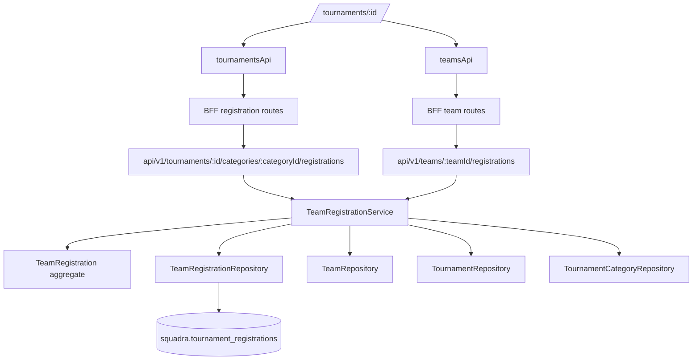

# Team Registration Design

**Spec**: `specs/active/team-registration/spec.md`
**Status**: Draft

---

## Architecture Overview

Team Registration is a category-owned participation slice. The backend creates and protects the `Team + Tournament + Category` registration invariant, while the frontend adds a category registration action for team administrators and a compact organizer list for category registrations.



## Code Reuse Analysis

| Component | Location | Use |
| --- | --- | --- |
| Team admin visibility/details | `domain/repositories/TeamRepository.java` | Add/read team admin context so only `TEAM_OWNER` and `TEAM_ADMIN` can register/cancel. |
| Tournament owner lookup | `domain/repositories/TournamentRepository.java` | Reuse `findOwnedByOrganizer` for organizer registration lists. |
| Category lookup | `domain/repositories/TournamentCategoryRepository.java` | Reuse `findByTournament` to validate category belongs to tournament and read `maxTeams`. |
| Tournament status enum | `domain/enums/TournamentStatus.java` | Allow team registration only for `OPEN` tournaments. |
| Category API conventions | `api/v1/tournaments/TournamentCategoriesResource.java` | Mirror nested category route structure and DTO style. |
| Team API conventions | `api/v1/teams/TeamsResource.java` | Add team-scoped own registration routes beside existing team management routes. |
| Reactive JDBC support | `infra/db/adapters/ReactiveJdbcSupport.java` | Follow current repository adapter pattern until persistence is migrated. |
| Tournament detail UI | `frontend/src/features/tournaments/tournament-detail.tsx` | Add category-level registration actions and organizer registration list. |
| Teams API client | `frontend/src/features/teams/api.ts` | Reuse user team list for team selection and add team registration list/cancel operations. |
| Tournament API client | `frontend/src/features/tournaments/api.ts` | Add category registration create/list operations with refresh retry. |

## Backend Components

### TeamRegistration Domain Entity

- **Location**: `backend/src/main/java/com/squadra/platform/domain/entities/TeamRegistration.java`
- **Purpose**: Represent a team's participation record for one tournament category.
- **Fields**:
  - `id`
  - `teamId`
  - `tournamentId`
  - `categoryId`
  - `status`
  - `createdAt`
  - `updatedAt`
- **Behavior**:
  - `create(teamId, tournamentId, categoryId, now)` creates `DRAFT`.
  - `cancel(now)` allows cancelling only `DRAFT` in this slice.
  - Validates required IDs, supported status, and timestamp updates.

### RegistrationStatus Enum

- **Location**: `backend/src/main/java/com/squadra/platform/domain/enums/RegistrationStatus.java`
- **Values**: `DRAFT`, `WAITING_ATHLETES`, `WAITING_PAYMENT`, `UNDER_REVIEW`, `APPROVED`, `REJECTED`, `CANCELLED`
- **Purpose**: Store the full documented registration lifecycle even though this slice only creates/cancels `DRAFT`.

### Repository Contract

- **Location**: `backend/src/main/java/com/squadra/platform/domain/repositories/TeamRegistrationRepository.java`
- **Methods**:
  - `create(TeamRegistration registration): Uni<TeamRegistrationDetails>`
  - `listByCategory(UUID tournamentId, UUID categoryId): Uni<List<TeamRegistrationDetails>>`
  - `listByTeam(UUID teamId): Uni<List<TeamRegistrationDetails>>`
  - `findByTeam(UUID teamId, UUID registrationId): Uni<Optional<TeamRegistrationDetails>>`
  - `activeExists(UUID categoryId, UUID teamId): Uni<Boolean>`
  - `activeCountByCategory(UUID categoryId): Uni<Integer>`
  - `save(TeamRegistration registration): Uni<TeamRegistrationDetails>`
- **Read model**:
  - `TeamRegistrationDetails` includes registration, team name, tournament name, and category name.

### Application Service

- **Location**:
  - `backend/src/main/java/com/squadra/platform/application/services/interfaces/TeamRegistrationService.java`
  - `backend/src/main/java/com/squadra/platform/application/services/impl/DefaultTeamRegistrationService.java`
- **Responsibilities**:
  - Validate team administration through `TeamRepository.findVisibleToUser`.
  - Validate tournament is visible/open for category registration.
  - Validate category belongs to tournament.
  - Enforce duplicate registration and category capacity.
  - Create `DRAFT` registrations.
  - List category registrations for tournament owners.
  - List and cancel team registrations for team admins.
  - Log safe create/cancel lifecycle events.
- **Commands**:
  - `RegisterTeamCommand(UUID teamId)`

### API Contract

- **Location**: `backend/src/main/java/com/squadra/platform/api/v1/registrations/`
- **Routes**:
  - `GET /api/v1/tournaments/{tournamentId}/categories/{categoryId}/registrations`
  - `POST /api/v1/tournaments/{tournamentId}/categories/{categoryId}/registrations`
  - `GET /api/v1/teams/{teamId}/registrations`
  - `POST /api/v1/teams/{teamId}/registrations/{registrationId}/cancel`
- **Request DTO**:
  - `RegistrationRequests.RegisterTeam` with `teamId`.
- **Response DTO**:
  - `RegistrationResponses.RegistrationDetails`.
- **Status codes**:
  - `201` for create.
  - `200` for lists and cancellation.
  - `401`, `403`, `404`, `409`, `422` for protected failure paths.
- **Compatibility**: Additive API change; no existing endpoint changes are required.

## Data Model

### Migration

Create `V8__create_tournament_registrations.sql`.

```text
tournament_registrations
- id uuid primary key
- team_id uuid not null references squadra.teams(id) on delete restrict
- tournament_id uuid not null references squadra.tournaments(id) on delete restrict
- category_id uuid not null references squadra.tournament_categories(id) on delete restrict
- status varchar(30) not null
- created_at timestamp with time zone not null
- updated_at timestamp with time zone not null
```

### Constraints and Indexes

- FK to teams, tournaments, and tournament categories.
- Check `status` in documented registration statuses.
- Unique active registration per category/team:
  - PostgreSQL partial unique index on `(category_id, team_id)` where `status NOT IN ('REJECTED', 'CANCELLED')`.
  - H2-compatible test strategy may use service-level checks plus migration syntax compatible with current test database if partial indexes are not portable.
- Index `(category_id, created_at)` for organizer category list.
- Index `(team_id, created_at)` for team registration list.
- Index `(tournament_id, category_id)` for category scoping checks.
- `ON DELETE RESTRICT` preserves registration history and prevents deleting referenced teams/categories/tournaments.

## Frontend Design

### Users and Goals

- **Team administrator**: choose one of my managed teams and register it in an open category.
- **Organizer**: see which teams started registration for each category.
- **Primary action**: `Inscrever equipe`.

### Interaction Model

- On tournament detail, category cards gain a registration area when the tournament is `OPEN`.
- Team admins see a team selector populated from `teamsApi.list`.
- Categories with existing registration for the selected team show the human-readable status instead of the create action.
- Organizers viewing their own tournament see a compact list/count of category registrations.
- Closed/cancelled/draft tournaments show Portuguese unavailable-state copy.
- Raw backend status enum values are translated before display.

### Human-Readable Status Labels

| Status | Label |
| --- | --- |
| `DRAFT` | `Rascunho` |
| `WAITING_ATHLETES` | `Aguardando atletas` |
| `WAITING_PAYMENT` | `Aguardando pagamento` |
| `UNDER_REVIEW` | `Em análise` |
| `APPROVED` | `Aprovada` |
| `REJECTED` | `Rejeitada` |
| `CANCELLED` | `Cancelada` |

## Error Handling

| Scenario | Backend | Frontend |
| --- | --- | --- |
| Unauthenticated | `401` | Refresh once, then show safe session error. |
| User is not team admin | `403` | Show Portuguese permission message. |
| Non-owner organizer list | `404` | Reuse tournament/category not found state. |
| Category outside tournament | `404` | Show category unavailable state. |
| Tournament not open | `409` | Disable/refresh registration action with explanatory copy. |
| Duplicate registration | `409` | Preserve selected team and show already-registered copy. |
| Category full | `409` | Preserve selected team and show category-full copy. |
| Invalid payload/unknown fields | `422` | Preserve selected team and show validation error. |

## Security and Observability

- Global roles are not enough; all mutations validate contextual team admin role.
- Organizer list validates tournament ownership and returns `404` for non-owner organizers.
- A user with team athlete membership but no administration receives `403` for registration create/cancel.
- Request IDs never prove access by themselves.
- Logs include safe identifiers only: action, actor user ID, team ID, tournament ID, category ID, registration ID, resulting status.
- Logs exclude tokens, authorization headers, payment payloads, athlete roster details, and provider secrets.

## Risks & Concerns

| Concern | Location | Impact | Mitigation |
| --- | --- | --- | --- |
| Existing persistence uses `ReactiveJdbcSupport` despite reactive-first guidance | `backend/src/main/java/com/squadra/platform/infra/db/repositories` | New feature may continue known technical debt. | Follow existing adapter pattern for consistency and keep all public contracts `Uni`; do not introduce blocking outside infra adapter. |
| Category deletion currently allowed before registrations | `DefaultTournamentCategoryService.delete` | Referenced categories could be deleted if delete behavior is not tightened. | Migration uses `ON DELETE RESTRICT`; category delete should map FK/dependency conflicts to `409`. |
| Capacity checks are concurrency-sensitive | `TeamRegistrationRepository` | Over-capacity categories could occur under racing requests. | Use repository transaction/locking or constraint-supported implementation; service tests cover duplicate/capacity and API tests cover conflict behavior. |
| Registration can be confused with approval | `docs/business-rules.md` | Teams may think `DRAFT` enters competition. | Frontend copy states registration has started and later steps are required; approved competition eligibility remains out of scope. |
| Frontend role inference is not security | `frontend/src/features/tournaments/tournament-detail.tsx` | UI could hide/show wrong actions. | Backend remains authoritative; frontend handles `403`/`409` responses and refreshes state. |

## Tech Decisions

| Decision | Choice | Rationale |
| --- | --- | --- |
| Initial status | `DRAFT` | Matches documented registration lifecycle and future roster/payment steps. |
| Registration create route | Nested under tournament category | The user chooses a category, and category scoping is central to the invariant. |
| Team registration list route | Nested under team | Team admins need an own-team participation view independent of organizer ownership. |
| Capacity accounting | Non-cancelled and non-rejected rows count | Draft/in-progress registrations reserve slots until they are cancelled/rejected. |
| Delete vs cancel | Cancel via status transition, no hard delete | Preserves audit/history and aligns future stateful registration lifecycle. |

## Validation Plan

- Domain tests for registration creation, cancellation, status bounds, and timestamp behavior.
- Application service tests for team-admin authorization, open tournament requirement, category scoping, duplicate checks, capacity checks, organizer list privacy, team list privacy, and safe logging trigger paths.
- API tests for create/list/cancel routes and `401`/`403`/`404`/`409`/`422`.
- Repository/API integration coverage for migration constraints, list order, duplicate uniqueness, and category delete conflict behavior.
- Frontend tests for team selector, registration CTA availability, successful create, duplicate/category-full errors, organizer registration list, cancellation state, and status labels.
- Full gates: backend verify, frontend check, frontend build after implementation.
