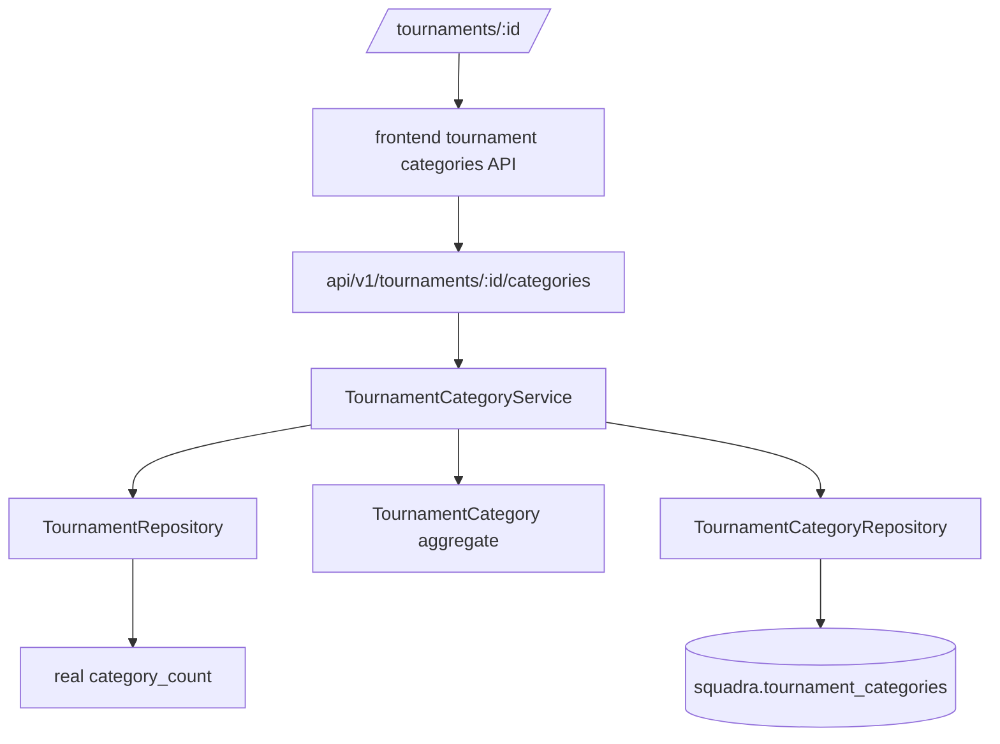

# Tournament Categories Design

**Spec**: `specs/active/tournament-categories/spec.md`
**Status**: Draft

---

## Architecture Overview

Tournament Categories are a tournament-owned vertical slice. The backend owns category validation, ownership checks, lifecycle constraints, money representation, and real category counts. The frontend adds category management to the existing organizer tournament detail screen and removes hardcoded category placeholder content.



## Code Reuse Analysis

| Component | Location | Use |
| --- | --- | --- |
| Tournament ownership lookup | `domain/repositories/TournamentRepository.java` | Reuse `findOwnedByOrganizer` before category operations. |
| Tournament lifecycle enum | `domain/enums/TournamentStatus.java` | Block category mutations for `CLOSED` and `CANCELLED`. |
| Existing API organization | `api/v1/tournaments` | Add nested category resource and DTOs under the tournament API area. |
| Existing exception mapping style | `api/v1/tournaments/mapper` | Extend mapping for category not found, duplicate name, and invalid state conflicts. |
| Reactive JDBC support | `infra/db/adapters/ReactiveJdbcSupport.java` | Keep repository contracts as `Uni` and follow existing isolated blocking adapter pattern. |
| Tournament frontend client | `frontend/src/features/tournaments/api.ts` | Add category types and category operations with the same auth refresh behavior. |
| Tournament detail screen | `frontend/src/features/tournaments/tournament-detail.tsx` | Replace placeholder category cards with list, form, edit, and delete interactions. |

## Backend Components

### TournamentCategory Domain Entity

- **Location**: `backend/src/main/java/com/squadra/platform/domain/entities/TournamentCategory.java`
- **Purpose**: Protect category invariants and timestamps.
- **Fields**:
  - `id`
  - `tournamentId`
  - `name`
  - `modality`
  - `minAthletes`
  - `maxAthletes`
  - `minTeams`
  - `maxTeams`
  - `paymentModel`
  - `priceInCents`
  - `competitionFormat`
  - `swissRounds`
  - `matchDurationMinutes`
  - `intervalBetweenMatchesMinutes`
  - `minimumRestMinutes`
  - `schedulingStrategy`
  - `createdAt`
  - `updatedAt`
- **Behavior**:
  - `create(UUID tournamentId, SaveFields fields, Instant now)`
  - `update(SaveFields fields, Instant now)`
  - validates field bounds, enum requirements, and Swiss round rules.

### Domain Enums

- **Location**: `backend/src/main/java/com/squadra/platform/domain/enums`
- **Enums**:
  - `TournamentModality`: `FIELD_SOCCER`, `FUTSAL`, `SOCIETY`
  - `CategoryPaymentModel`: `TEAM`, `ATHLETE`
  - `CompetitionFormat`: `ROUND_ROBIN`, `GROUP_STAGE`, `KNOCKOUT`, `GROUPS_PLUS_CUPS`, `SWISS`
  - `SchedulingStrategy`: `FASTEST_COMPLETION`, `BALANCED_REST`, `BALANCED_COURTS`, `HYBRID`, `MANUAL`

### Repository Contract

- **Location**: `backend/src/main/java/com/squadra/platform/domain/repositories/TournamentCategoryRepository.java`
- **Methods**:
  - `create(TournamentCategory category): Uni<TournamentCategory>`
  - `listByTournament(UUID tournamentId): Uni<List<TournamentCategory>>`
  - `findByTournament(UUID tournamentId, UUID categoryId): Uni<Optional<TournamentCategory>>`
  - `nameExists(UUID tournamentId, String normalizedName, UUID excludingCategoryId): Uni<Boolean>`
  - `save(TournamentCategory category): Uni<TournamentCategory>`
  - `delete(UUID tournamentId, UUID categoryId): Uni<Boolean>`

### Application Service

- **Location**:
  - `backend/src/main/java/com/squadra/platform/application/services/interfaces/TournamentCategoryService.java`
  - `backend/src/main/java/com/squadra/platform/application/services/impl/DefaultTournamentCategoryService.java`
- **Responsibilities**:
  - Validate parent tournament ownership through `TournamentRepository`.
  - Ensure tournament state permits category mutation.
  - Enforce duplicate category-name checks.
  - Orchestrate category create/list/detail/update/delete.
  - Log safe category lifecycle events.
- **Commands**:
  - Start with a nested `SaveCategoryCommand` record on the service interface, matching existing tournament style.

### API Contract

- **Location**: `backend/src/main/java/com/squadra/platform/api/v1/tournaments`
- **Routes**:
  - `GET /api/v1/tournaments/{tournamentId}/categories`
  - `POST /api/v1/tournaments/{tournamentId}/categories`
  - `GET /api/v1/tournaments/{tournamentId}/categories/{categoryId}`
  - `PUT /api/v1/tournaments/{tournamentId}/categories/{categoryId}`
  - `DELETE /api/v1/tournaments/{tournamentId}/categories/{categoryId}`
- **Request DTO**: `TournamentCategoryRequests.SaveCategory`
- **Response DTO**: `TournamentCategoryResponses.CategoryDetails`
- **Status codes**:
  - `201` for create.
  - `200` for list/detail/update.
  - `204` for delete.
  - `401`, `403`, `404`, `409`, and `422` for protected failure paths.
- **Compatibility**: Additive API change; no existing field is removed or renamed.

## Data Model

### Migration

Create `V7__create_tournament_categories.sql`.

```text
tournament_categories
- id uuid primary key
- tournament_id uuid not null references squadra.tournaments(id) on delete cascade
- name varchar(80) not null
- normalized_name varchar(80) not null
- modality varchar(30) not null
- min_athletes integer not null
- max_athletes integer not null
- min_teams integer not null
- max_teams integer not null
- payment_model varchar(20) not null
- price_in_cents bigint not null
- competition_format varchar(30) not null
- swiss_rounds integer null
- match_duration_minutes integer not null
- interval_between_matches_minutes integer not null
- minimum_rest_minutes integer not null
- scheduling_strategy varchar(40) not null
- created_at timestamp with time zone not null
- updated_at timestamp with time zone not null
```

### Constraints and Indexes

- Unique `(tournament_id, normalized_name)`.
- FK to `squadra.tournaments(id)`.
- Check supported enum values at database level.
- Check `min_athletes <= max_athletes`, `min_teams <= max_teams`, non-negative price, and duration ranges.
- Check `swiss_rounds` required only for `SWISS`.
- Index `(tournament_id, created_at)`.

### Tournament Category Count

Update `JdbcTournamentRepository.baseSelect()` to left join or subquery `tournament_categories` and return real `category_count` for list and detail responses.

## Frontend Design

### User and Goal

- **User**: `ORGANIZER`
- **Primary goal**: Configure each tournament division without spreadsheets.
- **Primary action**: Criar categoria.
- **Hierarchy**:
  1. Tournament context and status.
  2. Category readiness/count.
  3. Category list with key sports and operational settings.
  4. Create/edit form.
  5. Secondary scheduling/payment details.

### Interaction Model

- Replace hardcoded category cards with API data.
- Keep the form on the tournament detail page to avoid forcing a route jump during setup.
- Use Brazilian Portuguese labels for modalities, payment models, formats, and scheduling strategies.
- Render closed/cancelled tournaments as read-only category lists.
- Confirm deletion with a non-destructive browser/dialog pattern consistent with existing UI.
- Refresh category list and tournament detail cache after mutations so `categoryCount` updates.

### Form Fields

- Nome da categoria
- Modalidade
- Limite mínimo/máximo de atletas
- Limite mínimo/máximo de equipes
- Modelo de pagamento
- Valor
- Formato da competição
- Rodadas suíças, conditionally shown only for Swiss
- Duração da partida
- Intervalo entre partidas
- Descanso mínimo
- Estratégia de agenda

## Error Handling

| Scenario | Backend | Frontend |
| --- | --- | --- |
| Unauthenticated | `401` | Refresh once, then show session-safe error. |
| Athlete access | `403` | Show non-sensitive Portuguese error. |
| Non-owner organizer | `404` | Reuse tournament not found experience. |
| Invalid field | `422` | Preserve form values and show category form error. |
| Duplicate category name | `409` | Show name conflict near the form. |
| Closed/cancelled mutation | `409` | Refresh tournament and render read-only if needed. |
| Delete conflict from future registrations | `409` | Show that category already has dependencies. |

## Security and Observability

- Backend verifies global role with `@RequiresRoles(ORGANIZER)`.
- Application verifies tournament ownership before category access.
- Non-owner organizers receive `404` to reduce resource enumeration.
- Frontend values for price are never official payment state; backend stores cents.
- Logs include safe identifiers only: action, organizer user ID, tournament ID, category ID.
- Logs must not include tokens, authorization headers, provider payloads, or financial instrument data.

## Risks & Mitigations

| Risk | Impact | Mitigation |
| --- | --- | --- |
| Category config becomes too large for a single UI panel | Organizers may feel overwhelmed | Group form fields into identity, limits, payment, competition, and agenda sections. |
| Existing repository uses a blocking JDBC adapter despite reactive guidelines | New code may perpetuate known architectural debt | Follow existing `ReactiveJdbcSupport` pattern for consistency and do not add new blocking patterns outside that adapter. |
| Payment fields could be mistaken for real payment processing | Financial state could be trusted too early | Name fields as category configuration and keep payment execution out of scope. |
| Future registrations will restrict edits/deletes | Later features could break assumptions | Add service extension points and DB FK behavior so future dependencies return `409`. |

## Validation Plan

- Domain tests for category field validation and Swiss round rules.
- Application service tests for owner scoping, duplicate names, status mutation locks, and logging trigger paths.
- API tests for all routes and `401`/`403`/`404`/`409`/`422`.
- Repository/API integration coverage for real category counts.
- Frontend tests for category list, empty state, form validation, read-only states, mutations, and currency/enum labels.
- Full gates: backend verify, frontend check, frontend build when implementation is complete.
