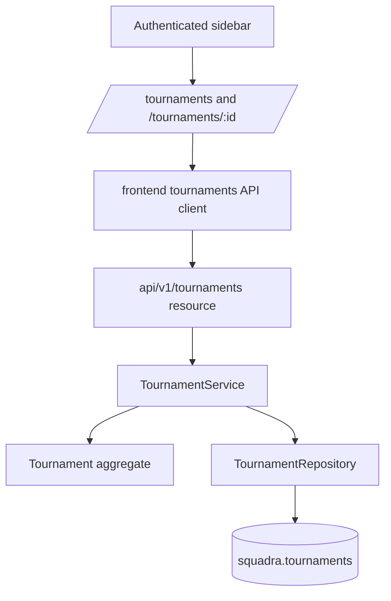

# Tournament Management Design

**Spec**: `specs/active/tournament-management/spec.md`
**Status**: Draft

---

## Architecture Overview

Tournament Management is an organizer-owned vertical slice. The backend owns authorization, validation, category separation, and status transitions. The frontend provides private organizer screens for listing, creating, editing, publishing, closing, reopening, and cancelling tournaments; category setup appears only as a next-step signal.



## Code Reuse Analysis

### Existing Components to Leverage

| Component | Location | How to Use |
| --- | --- | --- |
| Role filter | `backend/src/main/java/com/squadra/platform/api/filter` | Protect all tournament management routes with `@RequiresRoles(ORGANIZER)`. |
| Organizer profile pattern | `backend/src/main/java/com/squadra/platform/api/v1/organizers/profile` | Mirror authenticated organizer-owned resource conventions. |
| Team vertical slice | `backend/src/main/java/com/squadra/platform/api/v1/teams` and `frontend/src/features/teams` | Reuse list/detail route pattern, JSON validation style, and frontend auth retry pattern. |
| Reactive JDBC support | `backend/src/main/java/com/squadra/platform/infra/db/adapters/ReactiveJdbcSupport.java` | Keep repository methods returning `Uni` with blocking JDBC isolated behind the existing adapter. |
| Auth context | `frontend/src/features/auth/auth-context.tsx` | Use in-memory access token with one refresh retry. |
| App shell styles | `frontend/src/app/home/page.tsx`, `frontend/src/features/teams/team-shell.tsx`, `frontend/src/app/globals.css` | Reuse authenticated sidebar and sports-management visual language. |

### Integration Points

| System | Integration Method |
| --- | --- |
| Identity | `owner_organizer_user_id` references `squadra.users(id)` and route access requires `ORGANIZER`. |
| Organizer Profile | Future tournaments may display organizer profile information; this feature does not require a profile row. |
| Categories | No category table is created here. Tournament responses include `categoryCount` from a safe zero/default placeholder until category CRUD exists. |
| Frontend Navigation | Organizer sidebar links Tournaments to `/tournaments`; athletes do not receive organizer tournament management routes. |

## Components

### Tournament Domain

- **Purpose**: Encapsulates tournament identity, field validation, owner identity, timestamps, and status transitions.
- **Location**: `backend/src/main/java/com/squadra/platform/domain/entities/Tournament.java`
- **Interfaces**:
  - `create(UUID ownerOrganizerUserId, SaveFields fields, Instant now): Tournament`
  - `update(SaveFields fields, Instant now): void`
  - `publish(Instant now): void`
  - `close(Instant now): void`
  - `reopen(Instant now): void`
  - `cancel(Instant now): void`
- **Dependencies**: `TournamentStatus` enum.
- **Reuses**: Existing domain validation style from `Team` and profile entities.

### Tournament Repository

- **Purpose**: Persists organizer-owned tournaments and returns only owner-visible records.
- **Location**: `backend/src/main/java/com/squadra/platform/domain/repositories/TournamentRepository.java`
- **Interfaces**:
  - `create(Tournament tournament): Uni<TournamentDetails>`
  - `listForOrganizer(UUID organizerUserId): Uni<List<TournamentSummary>>`
  - `findOwnedByOrganizer(UUID tournamentId, UUID organizerUserId): Uni<Optional<TournamentDetails>>`
  - `save(Tournament tournament, UUID organizerUserId): Uni<TournamentDetails>`
- **Dependencies**: `ReactiveJdbcSupport`, Flyway migration.
- **Reuses**: `JdbcTeamRepository` query/result mapping style.

### Tournament Service

- **Purpose**: Orchestrates organizer authorization, category-boundary validation, lifecycle operations, and safe logging.
- **Location**: `backend/src/main/java/com/squadra/platform/application/services/interfaces/TournamentService.java` and `backend/src/main/java/com/squadra/platform/application/services/impl/DefaultTournamentService.java`
- **Interfaces**:
  - `create(UUID userId, SaveTournamentCommand command): Uni<TournamentDetails>`
  - `listMine(UUID userId): Uni<List<TournamentSummary>>`
  - `getMine(UUID userId, UUID tournamentId): Uni<TournamentDetails>`
  - `update(UUID userId, UUID tournamentId, SaveTournamentCommand command): Uni<TournamentDetails>`
  - `publish/close/reopen/cancel(UUID userId, UUID tournamentId): Uni<TournamentDetails>`
- **Dependencies**: `TournamentRepository`, `Clock`, application logger.
- **Reuses**: Team service ownership and exception patterns.

### Tournament API

- **Purpose**: Provides versioned REST endpoints and maps validation/lifecycle errors to deterministic status codes.
- **Location**: `backend/src/main/java/com/squadra/platform/api/v1/tournaments`
- **Interfaces**:
  - `GET /api/v1/tournaments`
  - `POST /api/v1/tournaments`
  - `GET /api/v1/tournaments/{tournamentId}`
  - `PUT /api/v1/tournaments/{tournamentId}`
  - `POST /api/v1/tournaments/{tournamentId}/publish`
  - `POST /api/v1/tournaments/{tournamentId}/close`
  - `POST /api/v1/tournaments/{tournamentId}/reopen`
  - `POST /api/v1/tournaments/{tournamentId}/cancel`
- **Dependencies**: Role filter and exception mappers.
- **Reuses**: Team API request/response/mapping conventions.

### Tournament Frontend

- **Purpose**: Gives organizers a private tournament list/create screen and tournament detail/status management screen.
- **Location**: `frontend/src/features/tournaments` and `frontend/src/app/tournaments`
- **Interfaces**:
  - `tournamentsApi.list/create/get/update/publish/close/reopen/cancel`
  - `TournamentListScreen`
  - `TournamentDetailScreen`
- **Dependencies**: `useAuth`, React Query, `react-hook-form`, `zod`.
- **Reuses**: Team shell and form patterns.

## Data Models

### Tournament

```text
tournaments
- id uuid primary key
- owner_organizer_user_id uuid not null references users(id)
- status text not null check in DRAFT/OPEN/CLOSED/CANCELLED
- name text not null
- description text null
- city text not null
- state text not null
- venue_name text null
- start_date date not null
- end_date date not null
- registration_deadline date not null
- rules text null
- published_at timestamp null
- closed_at timestamp null
- cancelled_at timestamp null
- created_at timestamp not null
- updated_at timestamp not null
```

**Relationships**: owned by one organizer user. Future `tournament_categories` will reference `tournaments(id)` after this feature.

### Frontend Types

```typescript
type TournamentStatus = "DRAFT" | "OPEN" | "CLOSED" | "CANCELLED";

type Tournament = {
  id: string;
  ownerOrganizerUserId: string;
  status: TournamentStatus;
  name: string;
  description?: string | null;
  city: string;
  state: string;
  venueName?: string | null;
  startDate: string;
  endDate: string;
  registrationDeadline: string;
  rules?: string | null;
  categoryCount: number;
  createdAt: string;
  updatedAt: string;
};
```

## Error Handling Strategy

| Error Scenario | Handling | User Impact |
| --- | --- | --- |
| Unauthenticated | `401` from auth filter | User sees sign-in/session recovery path. |
| Athlete access | `403` from role filter | Athlete cannot access organizer tournament management. |
| Non-owner organizer | `404` from service visibility lookup | Private tournament existence is not exposed. |
| Invalid fields/date ordering/category fields/unknown fields | `422` | Form keeps typed values and shows non-sensitive error. |
| Invalid lifecycle transition | `409` | Detail screen keeps current data and shows lifecycle conflict. |
| Cancelled edit | `409` | Cancelled tournaments render read-only. |

## Risks & Concerns

| Concern | Location | Impact | Mitigation |
| --- | --- | --- | --- |
| Existing docs include `IN_PROGRESS` and `FINISHED`, but current feature has no registrations/competition engine | `docs/tournaments-and-registrations.md` | Implementing those statuses now would create invalid transitions without domain signals. | Scope MVP status management to `DRAFT`, `OPEN`, `CLOSED`, `CANCELLED`; leave competition statuses for registration/competition features. |
| Category boundary could be blurred by convenient nested forms | `specs/active/tournament-management/spec.md` | Tournament payloads might silently include category data. | Reject category-like fields and omit category fields from frontend tournament forms. |
| Global strict Jackson unknown-field behavior affects older profile DTOs | Team Management implementation | Unknown-field behavior can break client-supplied ignored IDs in profile tests. | Keep profile DTO compatibility annotations and add tournament-specific unknown-field tests. |
| No Git repository present | current workspace | TLC atomic commits cannot be created. | Document limitation in validation; still run deterministic gates. |

## Tech Decisions

| Decision | Choice | Rationale |
| --- | --- | --- |
| Status enum | Implement only `DRAFT`, `OPEN`, `CLOSED`, `CANCELLED` | Other statuses require registration/competition state. |
| Category count | Return `0` from tournament repository until category table exists | Maintains response contract while categories remain separate future entity. |
| Frontend structure | Use `/tournaments` and `/tournaments/{tournamentId}` | Matches team management and keeps list/detail scalable. |
| UI exploration | Use Stitch before implementation when available | Significant organizer management screen and Squadra design guidance requires it. |
