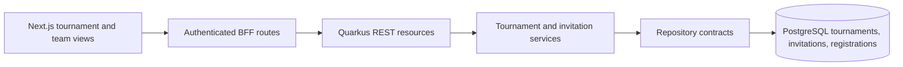

# Tournament Visibility and Team Invitations Design

**Spec**: `specs/active/tournament-visibility-invitations/spec.md`
**Status**: Implemented

## Architecture Overview

Use a dedicated invitation record. A public registration request continues to create a `DRAFT` registration. A private invitation has its own `PENDING -> ACCEPTED | REJECTED | CANCELLED` lifecycle; only acceptance creates the same `DRAFT` registration. Keeping invitation decisions separate avoids adding invitation-only states to the registration lifecycle.

## Approach Choice

| Option | Benefit | Cost |
| --- | --- | --- |
| Dedicated invitations table (recommended) | Clear decision history and existing registration states remain stable | New repository, migration, and API routes |
| Add `INVITED` to registrations | Fewer tables | Couples pre-acceptance to roster/payment flow and capacity counting |
| Token-only invites | Easy to share | Complicates contextual team authorization and private discovery |

## Code Reuse Analysis

| Component | Location | Use |
| --- | --- | --- |
| Tournament domain/service/repository | `backend/src/main/java/com/squadra/platform/{domain,application,infra}/` | Add visibility to save fields, reads, and update rule. |
| Team authorization | `domain/repositories/TeamRepository.java` | Validate `TEAM_OWNER` or `TEAM_ADMIN` at decision time. |
| Category scope | `domain/repositories/TournamentCategoryRepository.java` | Require category to belong to route tournament. |
| Registration service/repository | `DefaultTeamRegistrationService.java`, `TeamRegistrationRepository.java` | Reuse `DRAFT` creation and active-registration rules. |
| BFF/session helper | `frontend/src/lib/server/api/` | Proxy authenticated requests without token exposure. |
| Tournament/team views | `frontend/src/features/tournaments/`, `frontend/src/features/teams/` | Place invite creation with owner categories and inbox with team details. |

## Components and Interfaces

### Tournament Visibility

- Add `TournamentVisibility { PUBLIC, PRIVATE }` to domain and `visibility` to tournament save fields and responses.
- New rows default to `PUBLIC`; a Flyway migration adds `visibility VARCHAR(10) NOT NULL DEFAULT 'PUBLIC'` with a check constraint.
- Only a draft owner can change visibility. Other draft edits and current status transitions retain their existing rules.
- Add authenticated, paginated `GET /api/v1/tournaments/available` for `OPEN PUBLIC` summaries and `GET /api/v1/tournaments/{id}/overview` for accessible event/category details. The owner gets full details; invited/registered team admins get private details; unrelated users get `404`.
- Existing owner-only `GET /api/v1/tournaments/{id}` remains owner-scoped. Public/private accessible overview is a distinct read contract.

### Invitation Domain and Persistence

- `TournamentInvitation` stores ID, tournament/category/team IDs, inviter user ID, status, created/updated/decided timestamps.
- States: `PENDING`, `ACCEPTED`, `REJECTED`, `CANCELLED`; only `PENDING` can transition.
- Add `V10__create_tournament_invitations.sql` with FKs, status check, a nullable pending marker constrained by status, and a unique `(category_id, team_id, pending_key)` constraint. This allows only one pending invite while preserving multiple terminal history rows on PostgreSQL and H2.
- Invitation history is preserved; no hard delete. Creation locks the category and rechecks active registration inside the insert transaction, preventing a new pending invitation from racing acceptance of the previous invitation.
- Add `TournamentInvitationRepository` and an adapter under `infra/db/repositories`. Returned read models include team, tournament, and category display names only.

### Capacity and Transaction Boundary

- Replace the separate active-count/create sequence with one repository operation that locks the category row, checks active count and team uniqueness, then inserts a `DRAFT` registration in the same transaction. Both public requests and invitation acceptance call this operation.
- Invitation acceptance locks the category first and then the invitation row, and uses the same category capacity guard and marks the invitation `ACCEPTED` in the same transaction. Lock acquisition order is documented and consistent for cancellation/acceptance paths.
- Add a nullable active marker with a unique constraint on `(category_id, team_id, active_key)` in a forward Flyway migration after reconciling the current `UNIQUE(category_id, team_id, status)` constraint. Preserve historical cancelled/rejected rows. V12 explicitly rejects null markers in active/pending states, including SQL three-valued CHECK semantics.
- SQL state/constraint failures map to `409`; transaction rolls back the invitation decision and registration together.

### API Contract

| Route | Caller | Result |
| --- | --- | --- |
| `GET /api/v1/teams/directory?page=&size=&query=` | Organizer | Bounded team ID/name/location picker, no PII |
| `GET /api/v1/tournaments/{id}/categories/{categoryId}/invitations` | Tournament owner | Category invitation list |
| `POST /api/v1/tournaments/{id}/categories/{categoryId}/invitations` | Private tournament owner | `201 PENDING` invitation; body `{ teamId }` |
| `POST /api/v1/tournaments/{id}/categories/{categoryId}/invitations/{invitationId}/cancel` | Tournament owner | `200 CANCELLED` |
| `GET /api/v1/teams/{teamId}/tournament-invitations` | Team owner/admin | Team inbox |
| `POST /api/v1/teams/{teamId}/tournament-invitations/{invitationId}/accept` | Team owner/admin | `200 ACCEPTED`; registration is refreshed through the team registrations endpoint |
| `POST /api/v1/teams/{teamId}/tournament-invitations/{invitationId}/reject` | Team owner/admin | `200 REJECTED` |

All routes require authentication. Organizer-only and team-admin checks live in services. `404` hides foreign/private resources; `403` applies to a visible team the actor does not administer; `409` covers invalid state, duplicates, and capacity; `422` covers invalid bodies. Invitation response fields contain safe IDs, names, statuses, and timestamps.

## Frontend Design

- Tournament create/edit forms use a binary Publico/Privado control, with the edit control disabled once published.
- Authenticated tournament discovery lists real public open events. A tournament overview lets team admins select one of their managed teams and request registration by category.
- On private owner detail, each category includes a team picker/search and `Convidar equipe`; pending/decided invitations are listed with cancel for pending.
- Team detail adds `Convites para torneios`, showing tournament/category, `Pendente`, `Aceito`, `Recusado`, or `Cancelado` and accept/reject actions for pending.
- An invited admin can open private overview from the invitation. No unrelated team or invitation data is rendered.
- On success, invalidate relevant React Query keys. On conflict, keep the selected team and show a specific, safe pt-BR message.

## Error Handling and Privacy

| Condition | Backend | UI |
| --- | --- | --- |
| Unauthenticated | `401` | Session prompt |
| Team member without admin role | `403` | Permission message |
| Foreign/private tournament or invitation | `404` | Unavailable message |
| Duplicate, closed, public invite, or full category | `409` | Refresh state; preserve selection |
| Invalid input | `422` | Field error |

Log invite/send/accept/reject/cancel with action, actor ID, team ID, tournament ID, category ID, invitation ID, and result. Exclude emails, tokens, payment data, and athlete details. Redact request bodies in error logs.

## Risks & Concerns

| Concern | Location | Impact | Mitigation |
| --- | --- | --- | --- |
| Current active count and insert use separate JDBC connections | `DefaultTeamRegistrationService.java`, `JdbcTeamRegistrationRepository.java` | Concurrent requests can exceed max teams. | Introduce one transaction and category row lock shared by both entry paths. |
| Current status-level unique constraint is not active-registration uniqueness | `V8__create_tournament_registrations.sql` | Different active statuses can coexist; repeated cancelled rows can conflict. | Add forward migration with active-marker uniqueness and reconcile old constraint. |
| Tournament/category reads are owner-only | `TournamentsResource.java`, `TournamentCategoriesResource.java` | Team admins have no discovery or private invited view. | Add scoped read model/routes and backend visibility checks. |
| Team directory is currently private to associated users | `TeamRepository.java` | Owner cannot choose an unrelated team for invitations. | Add minimal, paginated organizer search without member/admin PII. |
| Existing persistence uses blocking JDBC behind `ReactiveJdbcSupport` | `infra/db/repositories/` | Transaction work needs careful isolation from event loop. | Keep I/O inside the existing worker-backed adapter and `Uni` contract; avoid new blocking calls in services. |
| Older tournament/category/registration work is uncommitted | worktree | Feature commits could accidentally capture earlier work. | Review staged paths and commit only this feature's intended hunks after approval. |

## Validation Plan

- Domain tests for visibility immutability and invitation transitions.
- API integration tests for role and private access matrices, owner invite creation/cancellation, team inbox and decision actions, malformed input, and retries.
- PostgreSQL-backed concurrency tests for last-slot acceptance versus public registration and repeated accept.
- Frontend client/component tests for public discovery, private owner invite controls, team inbox, pt-BR labels, and conflict states.
- Run backend `mvn verify`, frontend `npm run check` and `npm run build`; inspect migration on a database with existing tournament/registration data.
